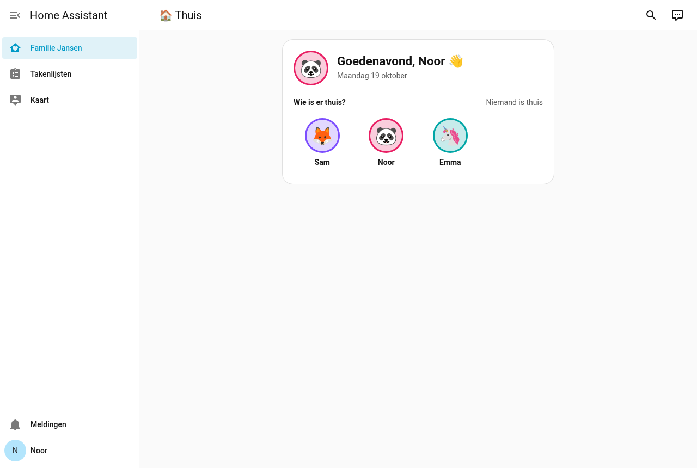
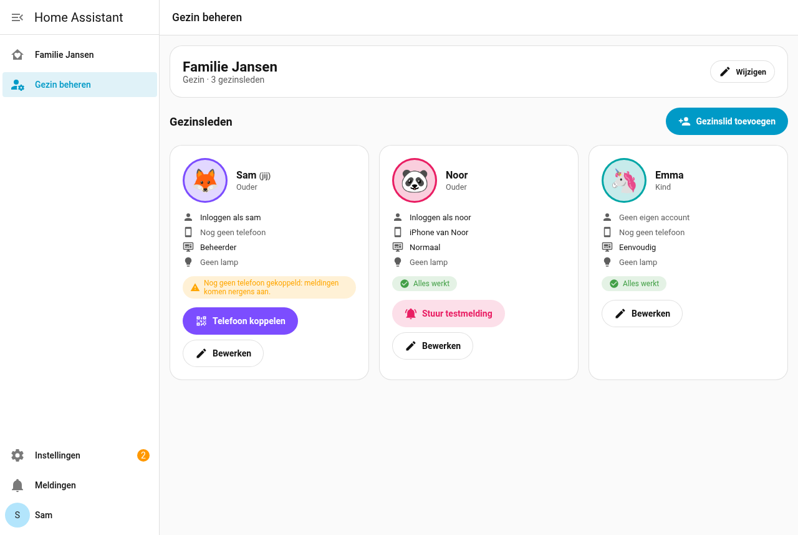
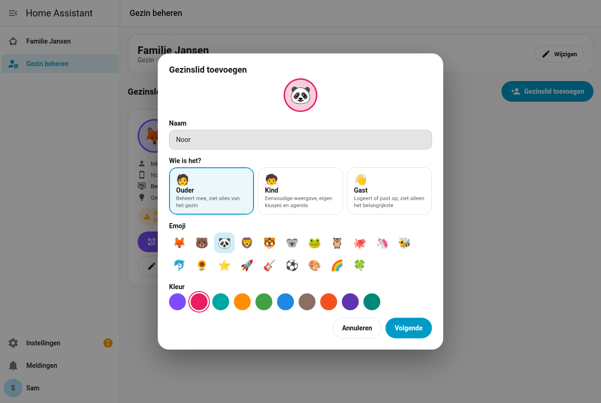
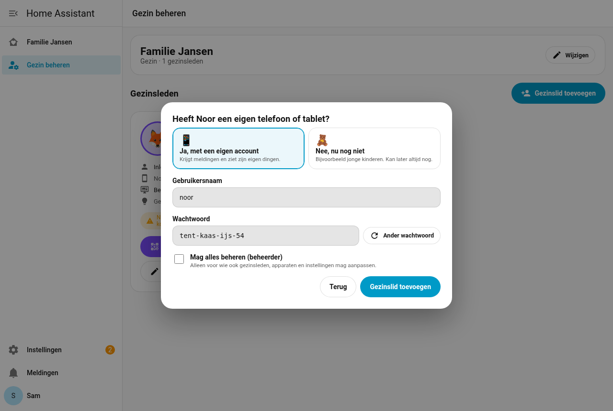
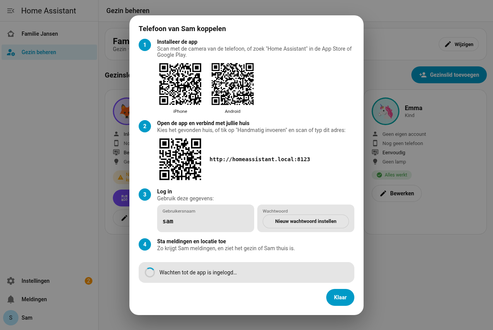
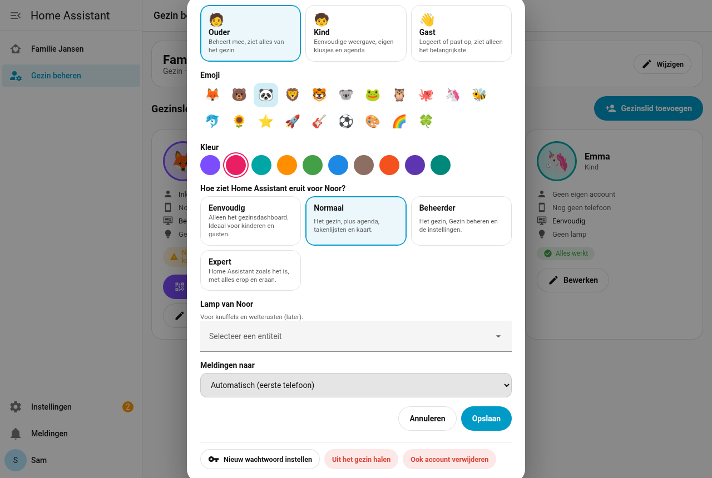

# HA Family

[](https://hacs.xyz/)
[](https://github.com/Rein033/ha-family/actions/workflows/validate.yml)
[](https://github.com/Rein033/ha-family/releases)

**Home Assistant voor het hele gezin, zonder dat je een geek hoeft te zijn.**

Installeer HA Family en Home Assistant wordt een gezinsapp. Iedereen opent meteen het gezinsdashboard, ziet alleen wat bij
hem past, en gezinsleden toevoegen of een telefoon koppelen gaat met een wizard in plaats van met instellingen, YAML en
entiteiten. Ook voor huishoudens met huisgenoten.

| Startscherm van Noor (normaal) | Gezin beheren |
|---|---|
|  |  |

## Wat gebeurt er als je het installeert

1. Er komt een **gezinsdashboard** in de zijbalk, met de naam van jullie gezin. Dat wordt ook het **startscherm** voor
   iedereen (ook nieuwe gebruikers en een tablet aan de muur).
2. Er komt een paneel **Gezin beheren**, alleen voor beheerders. Daar voeg je gezinsleden toe en koppel je telefoons.
3. Per gezinslid kies je hoe Home Assistant eruitziet. HA Family zet daarvoor het startscherm en de zijbalk van die persoon:

   | Weergave | Zijbalk | Voor |
   |---|---|---|
   | **Eenvoudig** | alleen het gezin | kinderen, gasten |
   | **Normaal** | gezin, agenda, takenlijsten, kaart | ouders en huisgenoten |
   | **Beheerder** | gezin, Gezin beheren, instellingen | wie beheert |
   | **Expert** | Home Assistant zoals het was | wie alles wil zien |

   Komen er later nieuwe dingen in de zijbalk (bijvoorbeeld via HACS), dan verbergt HA Family die ook bij wie niet
   *expert* is.

HA Family verandert Home Assistant zelf niet: het gebruikt de instellingen die Home Assistant per gebruiker bewaart. Kies
**Expert** of verwijder HA Family, en alles staat weer zoals het was. Updates van Home Assistant blijven gewoon werken.

## Installeren

1. HACS → ⋮ → **Custom repositories** → `https://github.com/Rein033/ha-family`, type **Integration**.
2. Zoek **HA Family** → **Download** → herstart Home Assistant.
3. **Instellingen → Apparaten & diensten → Integratie toevoegen → HA Family**: de naam van jullie gezin, en of jullie een
   gezin of een huishouden zijn.
4. Open **Gezin beheren** in de zijbalk.

## Gezin beheren

**Gezinslid toevoegen.** Naam, wie het is (ouder, kind, gast of huisgenoot), een emoji en een kleur. Daarna: heeft diegene
een eigen telefoon of tablet? Dan maakt HA Family in één keer de persoon én een account, met een wachtwoord dat je kunt
voorlezen (zoals `maan-tulp-vos-42`). Jonge kinderen kunnen ook zonder account.

| Wie is het? | Eigen telefoon? |
|---|---|
|  |  |

**Telefoon koppelen.** Vier stappen met QR-codes: de app installeren, verbinden met jullie huis, inloggen en meldingen
toestaan. Zodra de app is ingelogd, verschijnt er vanzelf een vinkje; meldingen gaan daarna automatisch naar die telefoon.
Met **Stuur testmelding** controleer je of het werkt.



**Gezondheidscheck.** Bij elk gezinslid zie je of alles werkt: account, telefoon, weergave en lamp. Is er iets mis (geen
telefoon, de app werkt niet meer, een lamp die er niet meer is), dan staat dat er in gewone taal bij, met een knop om het op
te lossen.

**Al in Home Assistant?** Bestaan er al personen, dan voeg je die met één klik toe als ouder, kind of huisgenoot.

**Bewerken.** Naam, rol, emoji, kleur, weergave, lamp, naar welke telefoon de meldingen gaan, een nieuw wachtwoord, of uit
het gezin halen (eventueel met het account).



## Kaarten

```yaml
type: custom:family-gezin-card     # groet, datum en wie er thuis is
```

Het hele dashboard: `strategy: { type: custom:ha-family }`. Wil je het zelf aanpassen: open het dashboard → ✏️ → **Overnemen**.

## Wat komt er

HA Family groeit functie voor functie. Elke functie krijgt een plek in het dashboard, eigen kaarten en, waar nodig, een
wizard in Gezin beheren.

- [x] **Fundament:** gezin, beheer, telefoons koppelen, weergave per gezinslid, gezinsdashboard
- [ ] **Gezinsagenda:** een kleur per persoon, maand of weekplanner, verjaardagen, afvalkalender
- [ ] **Taken en klusjes:** klusjes met punten voor kinderen, boodschappenlijst op looproute
- [ ] **Maaltijdplanner:** weekmenu, recepten, ingrediënten naar de boodschappen
- [ ] **Waar is iedereen:** "ik kom eraan", melding bij thuiskomst
- [ ] **Kinderen:** ochtend- en avondroutines, beloningen, zakgeld
- [ ] **Samen:** voor stellen (stemming, knuffels, date-pot; uit [Ons hokje](https://github.com/Rein033/ha-ons-hokje))
- [ ] **Systeem:** back-ups en updates in gewone taal, gezinsthema

## Hoe het in elkaar zit

Eén HACS-pakket met vier delen:

| Deel | Waar | Wat |
|---|---|---|
| HA-Family-Integrations | `custom_components/ha_family/*.py` | het gezin en de gegevens per functie, als gewone HA-entiteiten |
| HA-Family-Management | `websocket.py`, `weergave.py`, `frontend/family-beheer.js` | het beheerpaneel en de weergave per gezinslid |
| HA-Family-Cards | `frontend/family-cards.js`, `frontend/family-ui.js` | kaarten in één ontwerp |
| HA-Family-Dashboard | strategie `custom:ha-family` in `frontend/family-cards.js` | het dashboard dat zichzelf opbouwt |

## Privacy

Alles blijft op jullie eigen Home Assistant. Iedereen met een account ziet het gezin (namen, kleuren, wie er thuis is).
Alleen beheerders kunnen gezinsleden, accounts en telefoons beheren.

## Ontwikkelen

```bash
uv venv --python 3.13 .venv && VIRTUAL_ENV=.venv uv pip install pytest-homeassistant-custom-component
.venv/bin/python -m pytest
python3 scripts/gen_strings.py   # strings.json en vertalingen (nl/en)
```

Bij een nieuwe versie: `version` in `manifest.json`, `VERSIE` in `family-ui.js` en de `?v=` in de imports gelijk houden
(de CI controleert dat).
