# HA Family

[](https://hacs.xyz/)
[](https://github.com/Rein033/ha-family/actions/workflows/validate.yml)
[](https://github.com/Rein033/ha-family/releases)

**Home Assistant voor het hele gezin, zonder dat je een geek hoeft te zijn.**

Installeer HA Family en Home Assistant wordt een gezinsapp. Iedereen opent meteen het gezinsdashboard, ziet alleen wat bij
hem past, en gezinsleden toevoegen of een telefoon koppelen gaat met een wizard in plaats van met instellingen, YAML en
entiteiten. Ook voor huishoudens met huisgenoten.

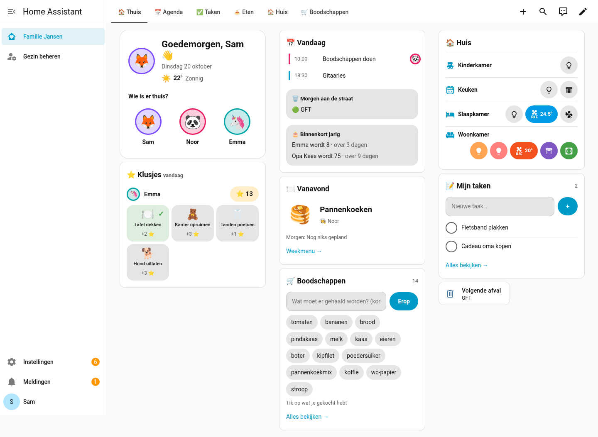

| Tablet aan de muur | Gezin beheren |
|---|---|
| 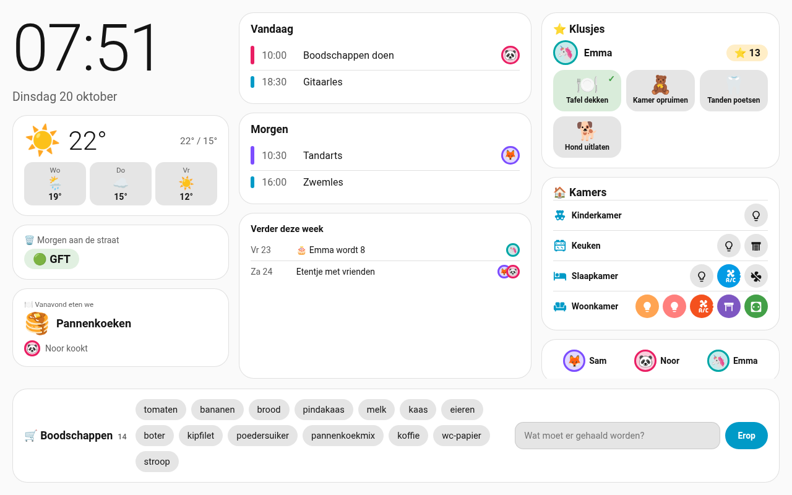 |  |

## Wat gebeurt er als je het installeert

1. Er komt een **gezinsdashboard** in de zijbalk, met de naam van jullie gezin. Dat wordt ook het **startscherm** voor
   iedereen (ook nieuwe gebruikers en een tablet aan de muur).
2. Er komt een paneel **Gezin beheren**, alleen voor beheerders. Daar voeg je gezinsleden toe en koppel je telefoons.
3. Per gezinslid kies je hoe Home Assistant eruitziet. HA Family zet daarvoor het startscherm en de zijbalk van die persoon:

   | Weergave | Zijbalk | Voor |
   |---|---|---|
   | **Eenvoudig** | alleen het gezin | kinderen, gasten |
   | **Normaal** | gezin, agenda, takenlijsten, kaart | ouders en huisgenoten |
   | **Beheerder** | gezin, Gezin beheren, instellingen | wie beheert |
   | **Expert** | Home Assistant zoals het was | wie alles wil zien |

   Komen er later nieuwe dingen in de zijbalk (bijvoorbeeld via HACS), dan verbergt HA Family die ook bij wie niet
   *expert* is.

HA Family verandert Home Assistant zelf niet: het gebruikt de instellingen die Home Assistant per gebruiker bewaart. Kies
**Expert** of verwijder HA Family, en alles staat weer zoals het was. Updates van Home Assistant blijven gewoon werken.

## Installeren

1. HACS → ⋮ → **Custom repositories** → `https://github.com/Rein033/ha-family`, type **Integration**.
2. Zoek **HA Family** → **Download** → herstart Home Assistant.
3. **Instellingen → Apparaten & diensten → Integratie toevoegen → HA Family**: de naam van jullie gezin, en of jullie een
   gezin of een huishouden zijn.
4. Open **Gezin beheren** in de zijbalk.

## Gezin beheren

**Gezinslid toevoegen.** Naam, wie het is (ouder, kind, gast of huisgenoot), een emoji en een kleur. Daarna: heeft diegene
een eigen telefoon of tablet? Dan maakt HA Family in één keer de persoon én een account, met een wachtwoord dat je kunt
voorlezen (zoals `maan-tulp-vos-42`). Jonge kinderen kunnen ook zonder account.

| Wie is het? | Eigen telefoon? |
|---|---|
|  |  |

**Telefoon koppelen.** Vier stappen met QR-codes: de app installeren, verbinden met jullie huis, inloggen en meldingen
toestaan. Zodra de app is ingelogd, verschijnt er vanzelf een vinkje; meldingen gaan daarna automatisch naar die telefoon.
Met **Stuur testmelding** controleer je of het werkt.


**Gezondheidscheck.** Bij elk gezinslid zie je of alles werkt: account, telefoon, weergave en lamp. Is er iets mis (geen
telefoon, de app werkt niet meer, een lamp die er niet meer is), dan staat dat er in gewone taal bij, met een knop om het op
te lossen.

**Al in Home Assistant?** Bestaan er al personen, dan voeg je die met één klik toe als ouder, kind of huisgenoot.

**Bewerken.** Naam, rol, emoji, kleur, weergave, lamp, naar welke telefoon de meldingen gaan, een nieuw wachtwoord, of uit
het gezin halen (eventueel met het account).


## AI

Is er in Home Assistant een AI gekoppeld (*AI Task*: bijvoorbeeld Ollama, OpenAI of Google), dan doet HA Family meer:

- **Dagoverzicht**: 's ochtends een kort, vrolijk overzicht van de dag in *Vandaag* (agenda, afval, eten, klusjes, weer);
- **Weekmenu bedenken**: vult de lege dagen met jullie eigen recepten, afwisselend, met jullie wensen ("vrijdag pizza");
- **Recept bedenken**: "iets snels met kip en rijst" wordt een recept met ingrediënten en bereiding;
- **Klusjes-ideeën** per kind, passend bij leeftijd en interesses;
- **Cadeau-ideeën** (zie Cadeaus).

Zonder AI werkt alles ook: dan komen weekmenu, klusjes en dagoverzicht uit HA Family zelf.

## Weergave per gezinslid

Per gezinslid kies je in **Gezin beheren → Bewerken** hoe Home Assistant eruitziet:

| Weergave | Zijbalk |
|---|---|
| Eenvoudig | alleen het gezinsdashboard (kinderen, gasten) |
| Normaal | gezin, agenda, takenlijsten en kaart |
| Beheerder | gezin, Gezin beheren en de instellingen |
| **Expert** | gezin, je persoonlijke dashboard, Gezin beheren en **Admin** (met daarin HACS) |
| Zoals het was | Home Assistant zonder aanpassingen |

**Admin** zet al het andere op één plek, met een zoekveld: automatiseringen, scripts, apparaten, instellingen, je eigen
dashboards, HACS en alle plugins en add-ons, en de AI. Wat je later installeert, komt er vanzelf bij. Wie al een account
had toen HA Family erbij kwam, staat eerst op *Zoals het was*.

**Bekijk als.** In Gezin beheren staat bij ieder gezinslid *Bekijk als*: je ziet HA Family zoals die persoon het ziet
(groet, klusjes, apparaten, cadeaus zonder de stiekeme aankopen). Alleen kijken: wat je doet, doe je als jezelf.

**Lampen en apparaten per persoon.** Bij *Bewerken* kies je *Alles* of *Zelf kiezen*: **per kamer** *Verborgen*, *Zien*
(met slotje) of *Bedienen*, voor alles in die kamer (ook wat er later bijkomt). Alleen als één apparaat anders moet, zet
je dat per apparaat. Met *Zelfde als* neem je de keuze van een ander gezinslid over. Handig voor kinderen. Let op: dit regelt wat HA Family laat zien en bedienen; Home Assistant
zelf kent geen rechten per apparaat.

**Persoonlijk dashboard.** In Bewerken maak je voor iemand een eigen dashboard (gewoon te bewerken) of koppel je een
bestaand dashboard, bijvoorbeeld met je 3D-printers. Het staat alleen in de zijbalk van die persoon. Let op: Home
Assistant kent geen dashboards per gebruiker; wie het adres weet, kan het openen.

## Startscherm

Iedereen opent op **Thuis**: een groet met het weer en wie er thuis is, de klusjes (een kind ziet alleen de eigen, als grote
tegels), *Vandaag* (afspraken, afval van morgen, wie er binnenkort jarig is), *Vanavond eten we*, de kamers met hun lampen
en airco, de boodschappen als tikbare lijstjes (tik op
wat je gekocht hebt) en *Mijn taken*. Toevoegen kan meteen vanaf het startscherm.

## Tablet aan de muur

Een groot scherm voor het hele gezin, zonder knoppen en balken van Home Assistant:

- **links** een grote klok, de datum, het weer met de komende dagen, welk afval er (morgen) aan de straat moet en wat we
  vanavond eten (en wie er kookt);
- **midden** de agenda van vandaag en morgen en de rest van de week, in de kleur van wie het betreft;
- **rechts** de klusjes per kind (aanraken = gedaan, met een feestje), **de kamers** (tik op een lamp of de airco om hem
  aan of uit te zetten) en wie er thuis is;
- **onderaan** de boodschappen: tik op wat er gekocht is, of zet er meteen iets bij.

's Nachts staat er alleen een gedimde klok (die langzaam verschuift tegen inbranden); aanraken maakt hem twee minuten
wakker. Het scherm blijft aan waar de browser dat toestaat. Staand of liggend werkt allebei.

| Overdag | 's Nachts | Staand |
|---|---|---|
| 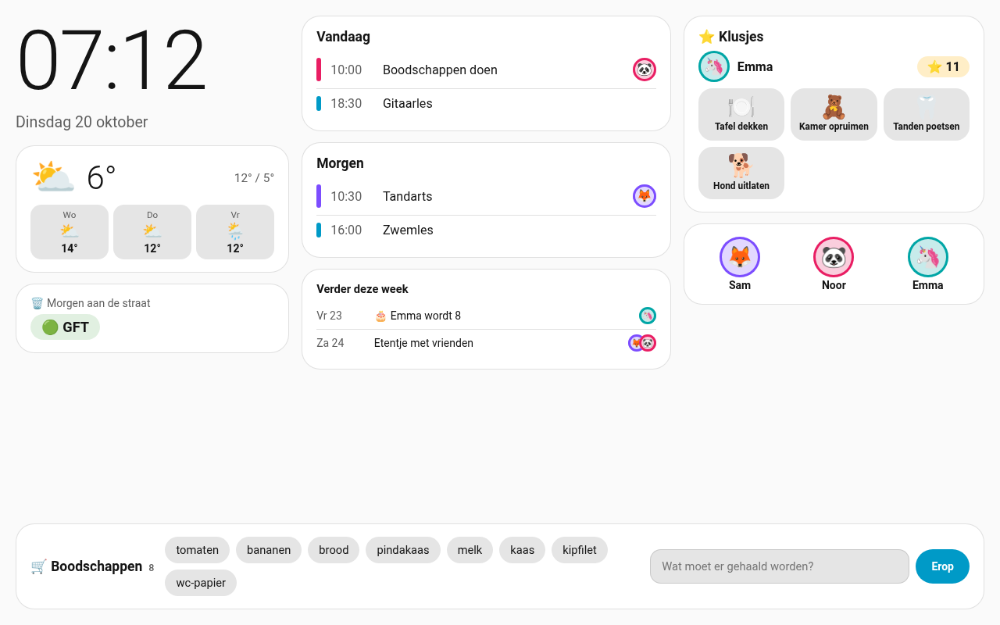 | 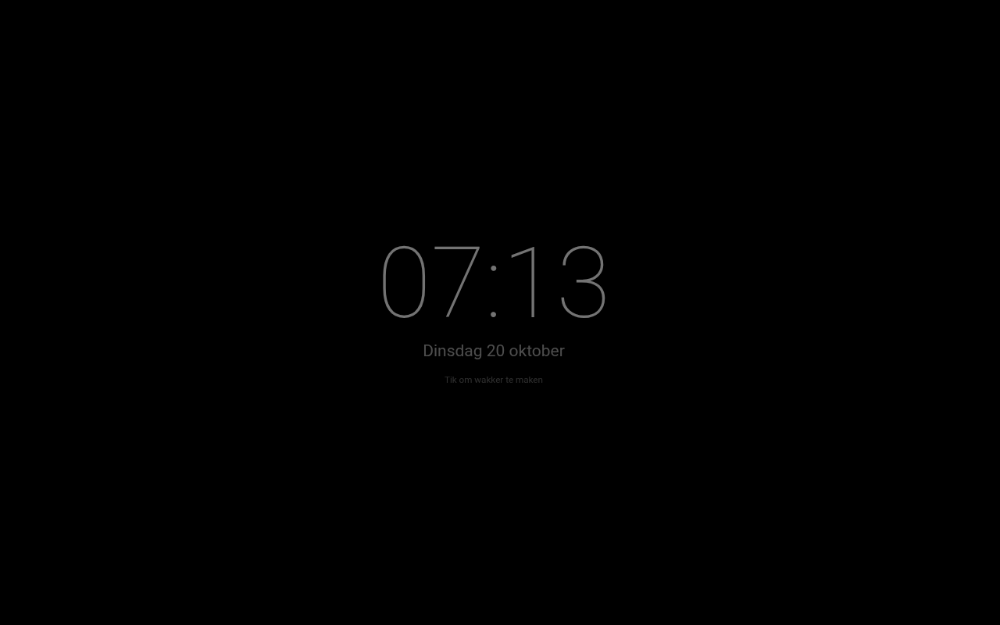 | 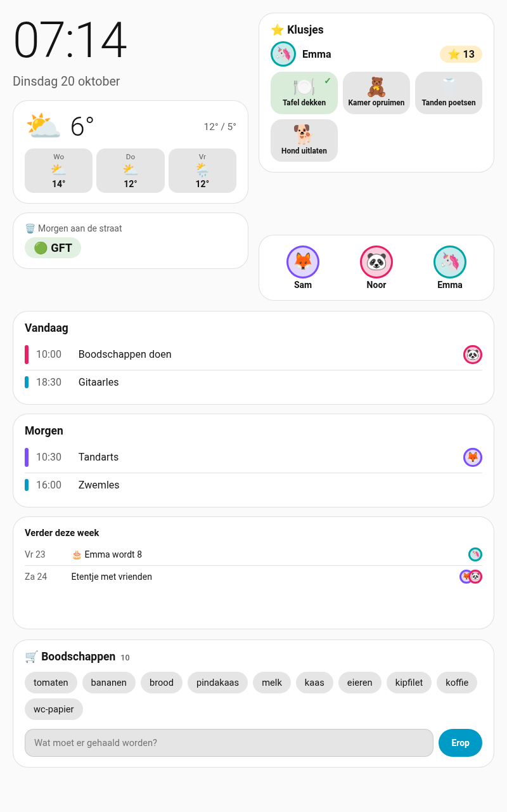 |

**Instellen** in **Gezin beheren → Muurscherm**: één klik maakt een apart account *muur* dat **alleen thuis** kan inloggen.
Open het getoonde adres (of scan de QR-code) op de tablet, in de browser, de Home Assistant-app of een kiosk-app zoals
Fully Kiosk Browser, en log in met dat account. Het muurscherm wordt dan het startscherm van de tablet en de zijbalk
verdwijnt. Op de muur kunnen kinderen hun klusjes afvinken (met goedkeuring als dat nodig is) en kan iedereen boodschappen
toevoegen; beheren kan er niet. Je kiest er ook de nachtstand (van–tot), het weerbericht en welke onderdelen erop staan.

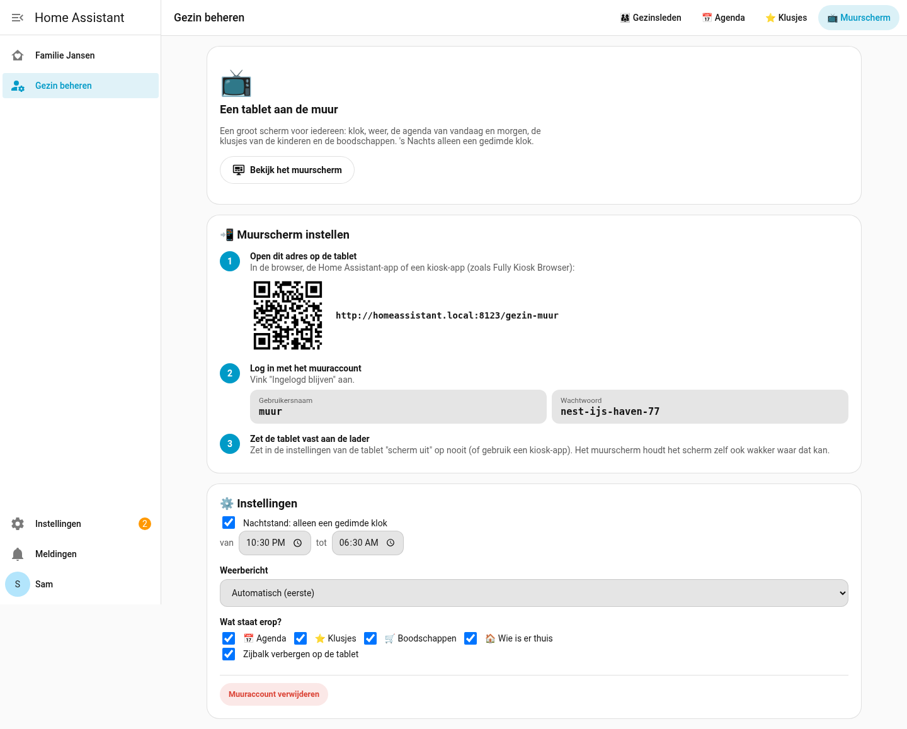

## Gezinsagenda

Alle afspraken van het gezin op één plek, in de kleur van wie het betreft. Ieder kiest zelf hoe de agenda eruitziet
(Home Assistant onthoudt het per persoon):

- **Maand**: een blokkenkalender met een gekleurd puntje per gezinslid, 🟢🟠🔵 voor afval en 🎂 voor verjaardagen. Tik op
  een dag voor de afspraken.
- **Weken**: een weekplanner. Elke week kan een titel krijgen (zoals *Herfstvakantie*), per dag staan de afspraken als
  labels met de avatar van wie het betreft.

| Maand | Weken | Telefoon |
|---|---|---|
| 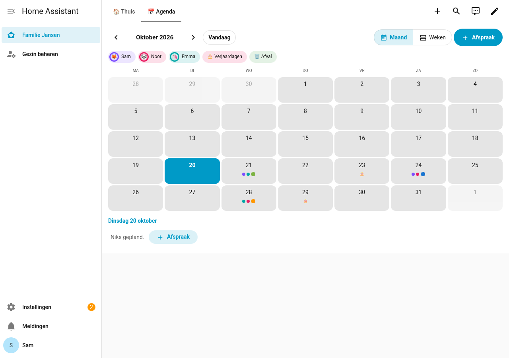 | 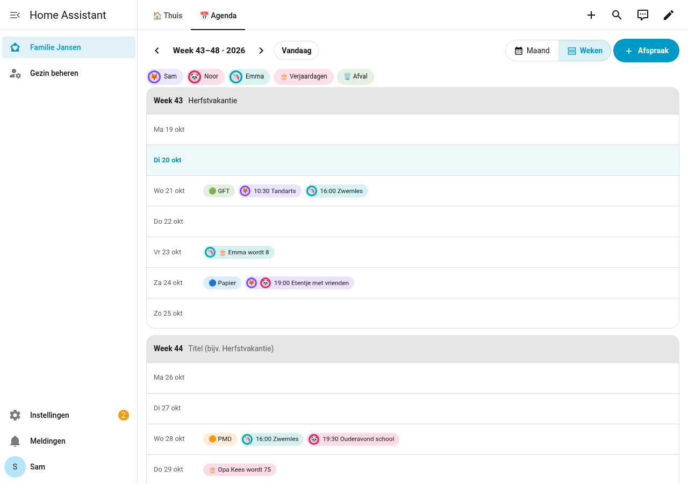 | 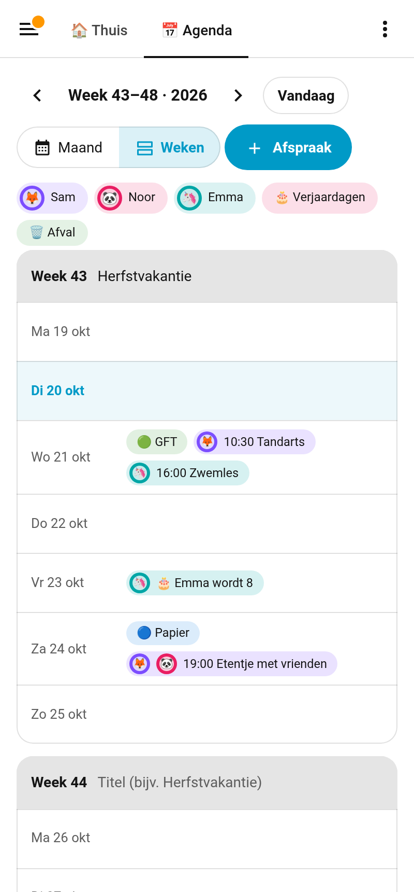 |

**Afspraak maken.** Met **+ Afspraak** (of de **+** achter een dag): wat, wanneer, de hele dag of van–tot, **voor wie**
(tik op de avatars), herhalen (elke week, om de week, elke maand, elk jaar), waar en een notitie. Tik op een afspraak om hem
te bewerken of te verwijderen. Afspraken uit gekoppelde agenda's kun je bekijken.

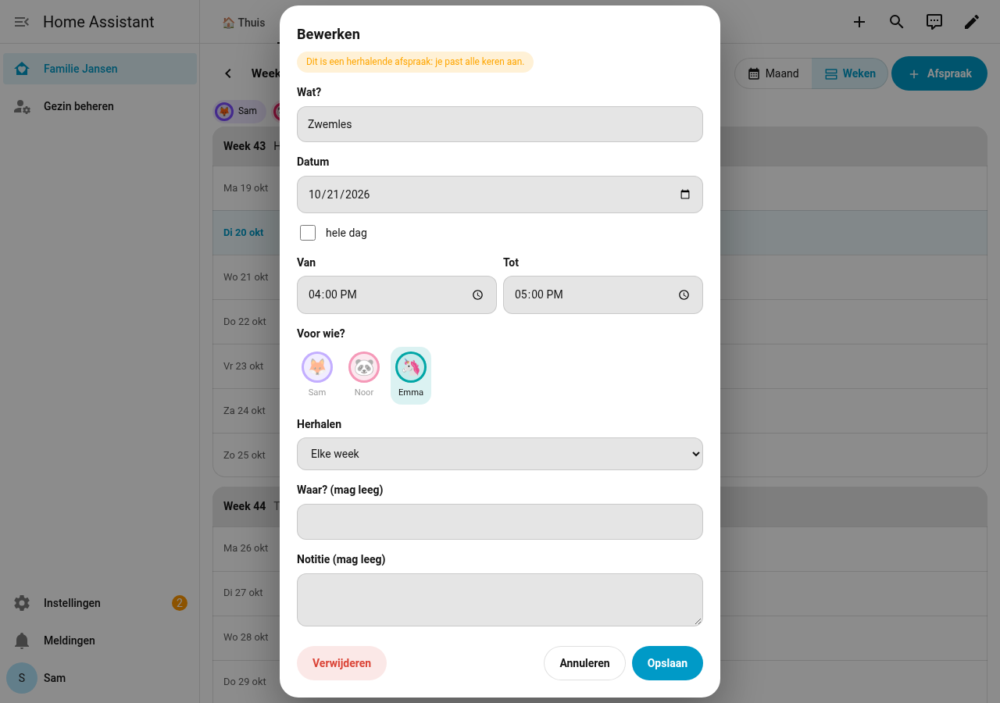

**Wat er allemaal in komt** (in te stellen bij **Gezin beheren → Agenda**):

- **Agenda's per gezinslid**: een agenda die al in Home Assistant staat, of een link (Google Agenda, iCloud, Outlook). Die
  afspraken krijgen de kleur van dat gezinslid. Waar je de link vindt, staat er gewoon bij.
- **Gezamenlijke agenda's**: school, sport, vakanties of feestdagen, in de kleur van het gezin.
- **Verjaardagen**: de geboortedatum van gezinsleden en een lijst met opa, oma en vrienden (jaar mag onbekend zijn). In de
  agenda staat *🎂 Emma wordt 8*, en 's ochtends krijgt iedereen een seintje (de jarige krijgt een felicitatie).
- **Afvalkalender**: zelf invullen (per soort de volgende ophaaldag en elke hoeveel weken), een link van de gemeente, of een
  agenda die je al hebt. De avond ervoor krijgt het gezin *"Morgen: 🟢 GFT. Zet de container vanavond aan de straat."*

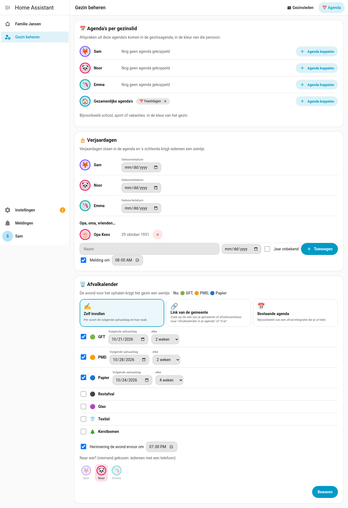

Op het tabblad **Thuis** staat een **Vandaag**-kaart: de afspraken van vandaag, welk afval er morgen aan de straat moet en
wie er binnenkort jarig is.

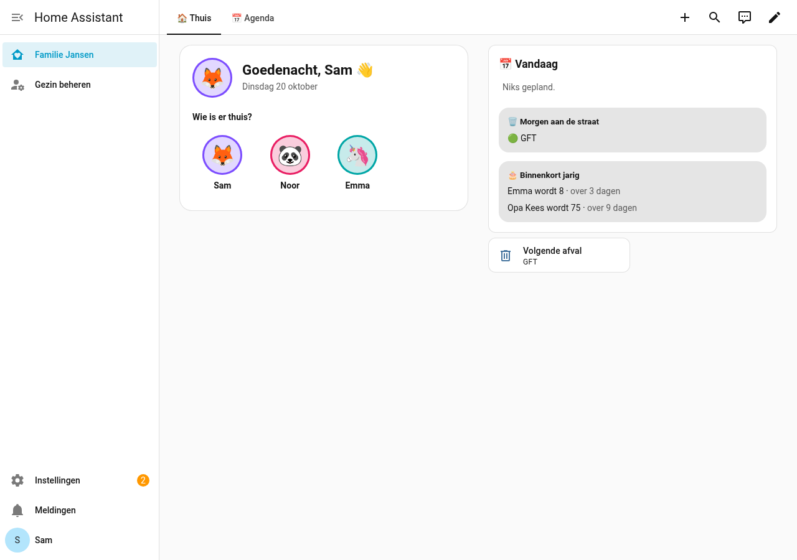

In Home Assistant zelf komen er drie agenda's bij (**Gezinsagenda**, **Verjaardagen**, **Afval**) en een sensor **Volgende
afval**, voor automatiseringen, Assist en de gewone agenda van Home Assistant.

**Afval van je afvalbedrijf.** In **Gezin beheren → Agenda → Afvalkalender** kies je *Mijn afvalbedrijf*, vult
postcode en huisnummer in, en de ophaaldagen komen er vanzelf in (twee keer per dag bijgewerkt). Nu: **ROVA** (Amersfoort,
Zwolle, Utrechtse Heuvelrug en meer); andere bedrijven kunnen erbij. Zelf invullen, een iCal-link of een bestaande agenda
kan ook nog.

## Klusjes, taken en boodschappen

**Klusjes met punten.** Een ouder maakt klusjes aan in **Gezin beheren → Klusjes** (of kiest een voorbeeld, zoals
*🍽️ Tafel dekken*): hoeveel punten, voor wie, en wanneer (elke dag, werkdagen, weekend, bepaalde dagen of één keer).
Een kind ziet zijn klusjes van vandaag als grote tegels op het startscherm. Tik erop en het is gedaan, met een feestje en
sterren.

- **Goedkeuren**: zet je bij een klusje *Een ouder moet het goedkeuren* aan, dan krijgen de ouders een melding met de knoppen
  **Goedkeuren** en **Nog niet**, direct op de telefoon. In het dashboard staat het onder *Wacht op jou*.
- **Beloningen**: zoals *🍦 IJsje = 15 sterren* of *🎬 Film kiezen = 20*. Het kind ziet hoe ver het nog is; heeft het genoeg,
  dan vraagt het de beloning aan en keurt een ouder goed.
- **Extra punten**: geef (of haal af) met één tik, bijvoorbeeld voor goed helpen.
- **Herinnering**: 's avonds een seintje aan wie nog klusjes open heeft.

| Kind (telefoon) | Ouder: wacht op jou | Na goedkeuren |
|---|---|---|
| 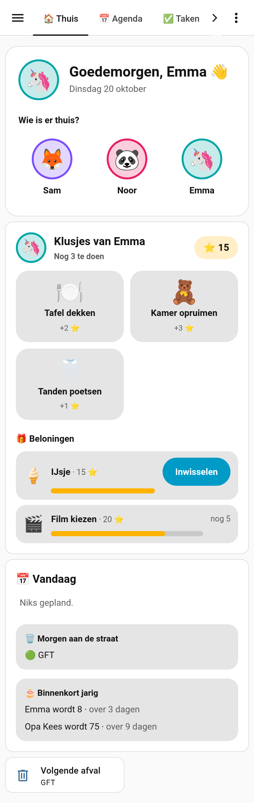 | 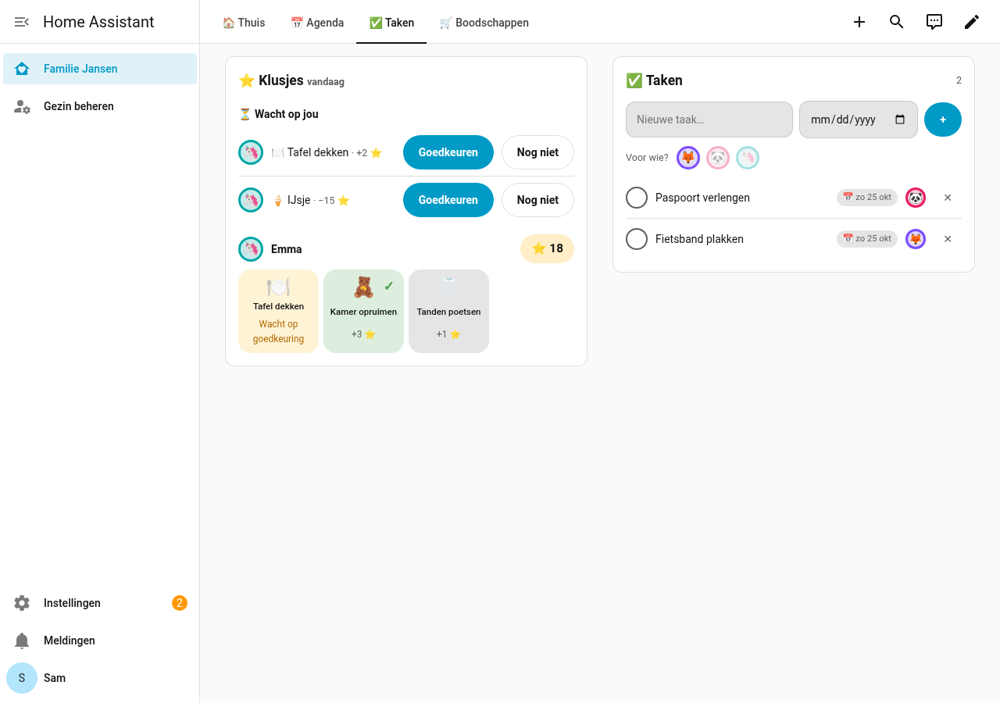 | 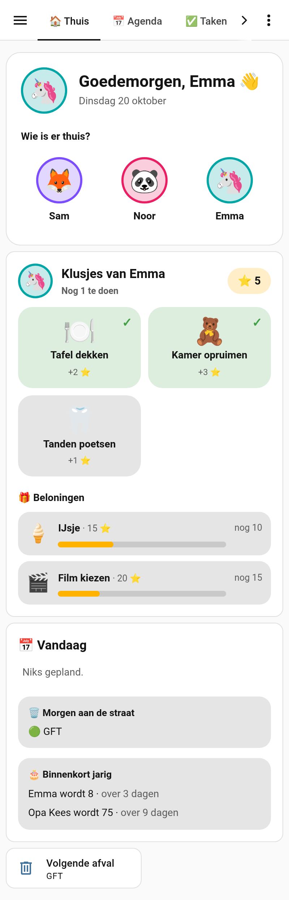 |

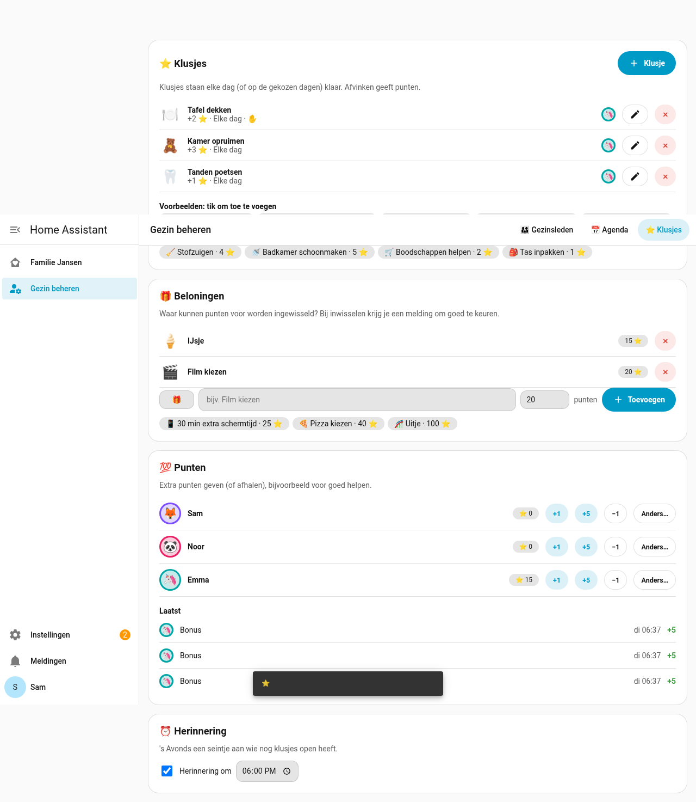

**Taken.** Gezinstaken met *voor wie* (tik op de avatars) en een deadline. Te laat staat in het rood. Ook een gewone
to-do-lijst in Home Assistant, dus ook te gebruiken met Assist: *"Zet fietsband plakken op Taken"*.

**Boodschappen.** Typ wat er nodig is; met komma's zet je meer dingen tegelijk op de lijst (`melk, brood, tomaten`). De lijst
sorteert zichzelf op de looproute in de winkel: groente & fruit, brood, zuivel, vlees, pasta & rijst, snoep, diepvries,
drinken, huishouden, verzorging. Staat iets bij de verkeerde afdeling, tik dan op 🏷️. Ook met Assist: *"Zet melk op de
boodschappenlijst"*.

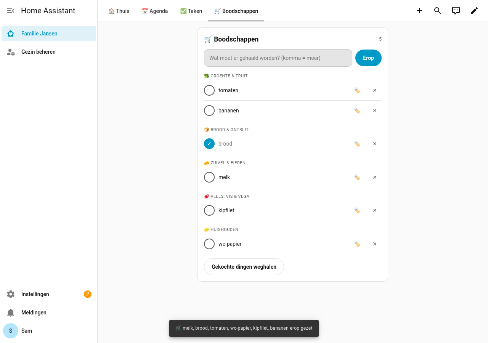

**Een account voor later.** Krijgt een kind (of iemand anders zonder account) een eigen telefoon? Open het gezinslid in
**Gezin beheren → Bewerken** en kies **Geef … een eigen account**; je gaat meteen door naar telefoon koppelen.

## Maaltijdplanner

**Weekmenu.** Op het tabblad **🍝 Eten** staat de week: tik op een dag en kies een recept, typ zelf iets (*Restjes*,
*Uit eten*) of laat **🎲 Verrassing** kiezen (een gerecht dat de afgelopen twee weken niet op het menu stond; favorieten
vaker). Kies er meteen bij wie er kookt. Op het startscherm en op het muurscherm staat *Vanavond eten we*.

**Recepten.** Begin met tien bekende gezinsgerechten (één klik), maak zelf een recept (emoji, ingrediënten, bereiding,
labels zoals ⚡ Snel en 🥕 Vega), of plak de link van een receptensite: HA Family haalt naam, foto, ingrediënten en
bereiding van de pagina (werkt met de meeste sites, zoals Allerhande en 24Kitchen).

**Naar de boodschappen.** *🛒 Week op de lijst* zet de ingrediënten van de hele week op de boodschappenlijst, of doe het per
gerecht. Hoeveelheden gaan eraf (`500 g gehakt` → *gehakt*), wat er al op staat komt er niet dubbel op, en alles komt
meteen op de looproute.

**Herinnering.** 's Middags (standaard 16:00) krijgt de kok een berichtje: *Vanavond kook jij: Pannenkoeken*. Staat er niets,
dan krijgen de ouders een idee. Aan of uit onder het weekmenu. Ook als sensor *Eten vandaag*, voor eigen automatiseringen.

| Weekmenu en recepten | Gerecht kiezen | Recept |
|---|---|---|
| 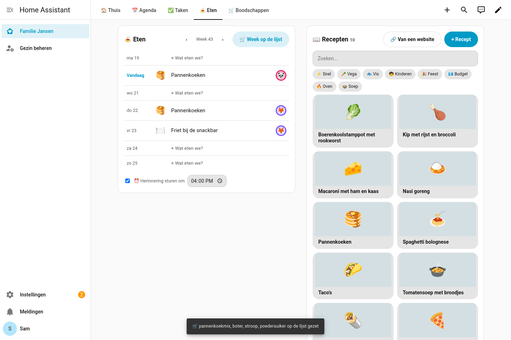 | 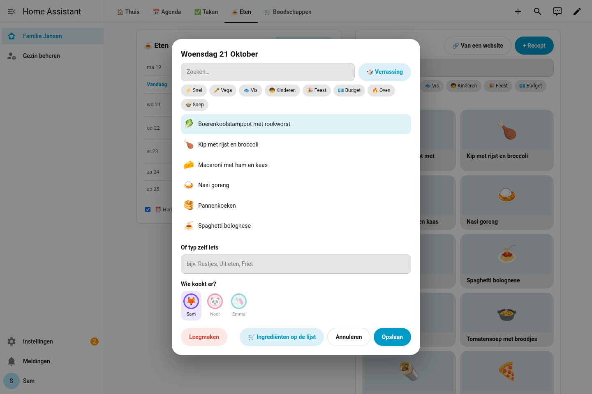 | 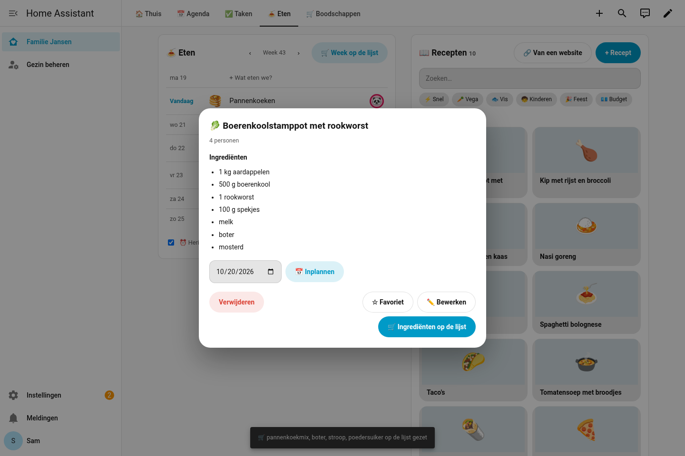 |

## Kamers

Lampen, airco en de rest, **per kamer**. Tik op de airco, een rolluik, speaker of ventilator voor het bedieningspaneel:
temperatuur, stand (koelen, verwarmen, drogen …), ventilatorsnelheid, zwenken, positie of volume. Lang drukken op een lamp
geeft helderheid en lichtkleur. op het tabblad **🏠 Huis**, rechts op het muurscherm en op het startscherm. Tik op
een lamp om hem aan of uit te zetten, schuif voor de helderheid; bij de airco of thermostaat zet je hem aan/uit en de
temperatuur met − en +; rolluiken gaan op ▲ ■ ▼. *Alles uit* zet alle lampen in een kamer uit.

**Snel aanpassen**: tik op de kamers-kaart op **✏️ Aanpassen** (beheerders): met het oogje haal je een lamp van het
dashboard, en apparaten zonder kamer (onder *Overig*) zet je meteen in een kamer.

**Instellen** in **Gezin beheren → Huis**:

1. **Kamer aanmaken**: naam en icoon, of met één klik *Woonkamer*, *Keuken*, *Kinderkamer*, …
2. **Apparaten toevoegen**: bovenaan staat alles wat nog geen kamer heeft. Vink apparaten aan en zet ze in één keer in een
   kamer, of kies per apparaat. Filter op lampen, klimaat, ventilatoren, rolluiken, stopcontacten of speakers.
3. Hernoemen, verbergen (niet op het dashboard en de muur) of verwijderen per kamer.

Kamers zijn gewoon de ruimtes (areas) van Home Assistant: wat je hier doet, zie je ook in de rest van HA, in Assist en in
automatiseringen, en kamers die je al had staan er meteen.

| Huis | Instellen |
|---|---|
| 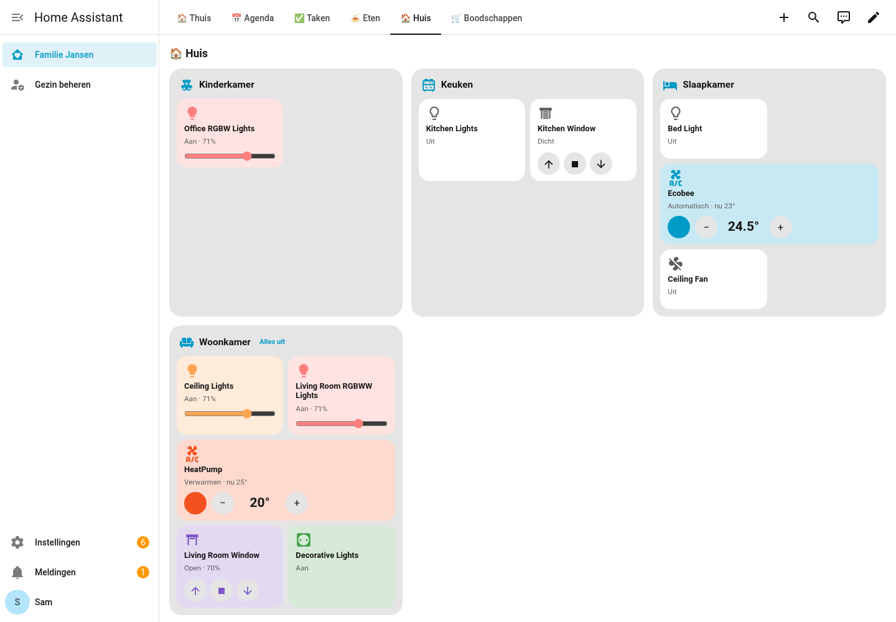 | 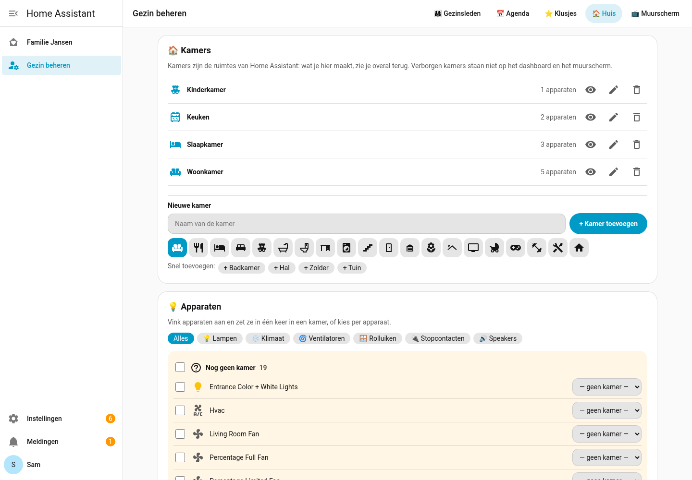 |

## Cadeaus en verlanglijstjes

**Over iedereen.** In **Gezin beheren → Bewerken** staan per gezinslid de geboortedatum, het geslacht en de interesses
(voetbal, paarden, gamen, … of zelf iets typen). Iedereen kan zijn eigen interesses ook aanpassen op het tabblad Cadeaus.

**Verlanglijstje.** Op het tabblad **🎁 Cadeaus** zet iedereen zijn wensen op een lijstje, met prijs, link en een notitie
(*maat 38, zwart*). Ouders helpen de kinderen met hun lijstje. Met **📤 Sturen naar…** krijgt wie je kiest een melding met
het lijstje op de telefoon.

**Stiekem afvinken.** Bij het lijstje van een ander tik je op *Ik koop dit*. De anderen zien dat het al gekocht wordt,
zodat niemand hetzelfde koopt, maar de eigenaar ziet nooit wát er gekocht is of door wie.

**Cadeau-ideeën.** Kies iemand, een budget en waarvoor (verjaardag, Sinterklaas, kerst, zomaar), en HA Family bedenkt
ideeën die passen bij leeftijd, geslacht en interesses, en die nog niet op het lijstje staan. Is er in Home Assistant
een AI gekoppeld (*AI Task*, bijvoorbeeld Ollama, OpenAI of Google), dan bedenkt die ze; anders komen ze uit een eigen
ideeënlijst. Bewaar wat je leuk vindt met ⭐: die lijst is alleen voor jou.

**Herinnering.** Twee weken voor iemands verjaardag krijgen de anderen een seintje, met wat er nog op het lijstje staat.

| Lijstje van een ander, met ideeën | Mijn lijstje | Over een gezinslid |
|---|---|---|
| 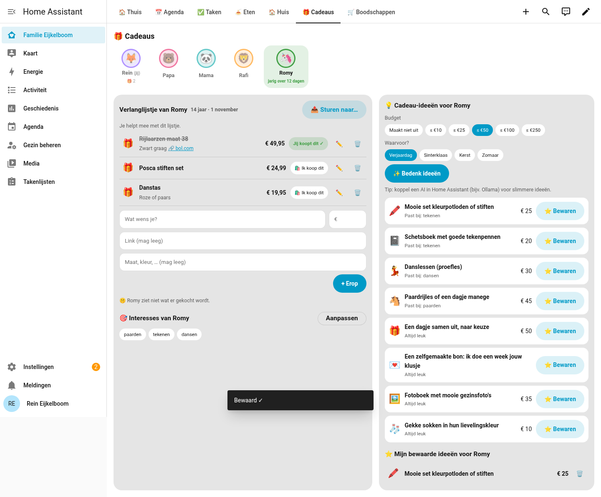 | 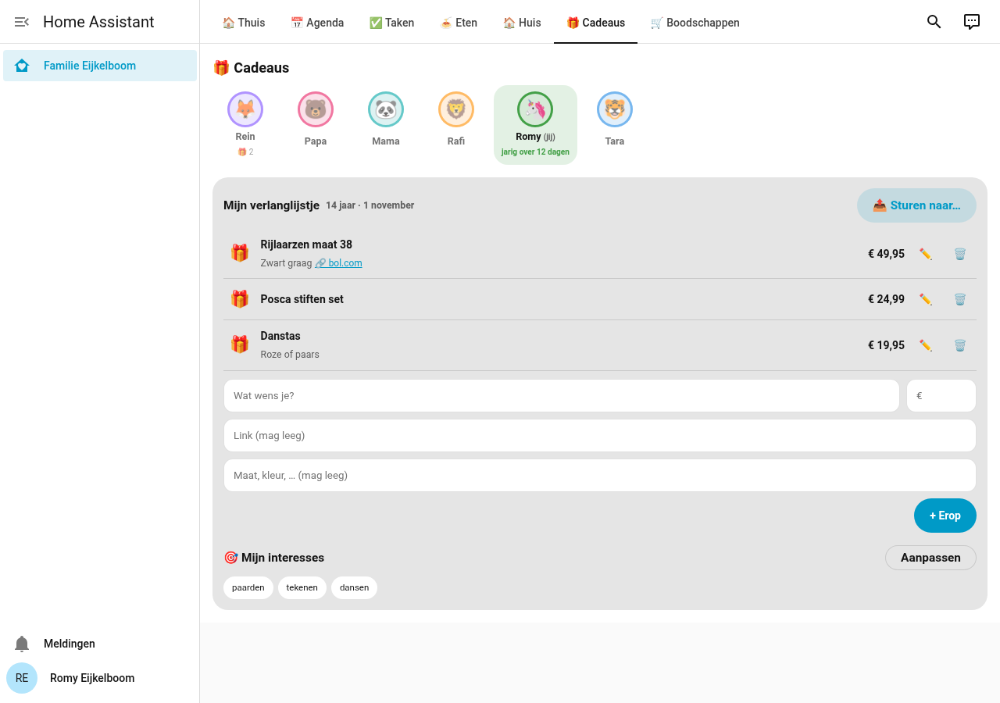 | 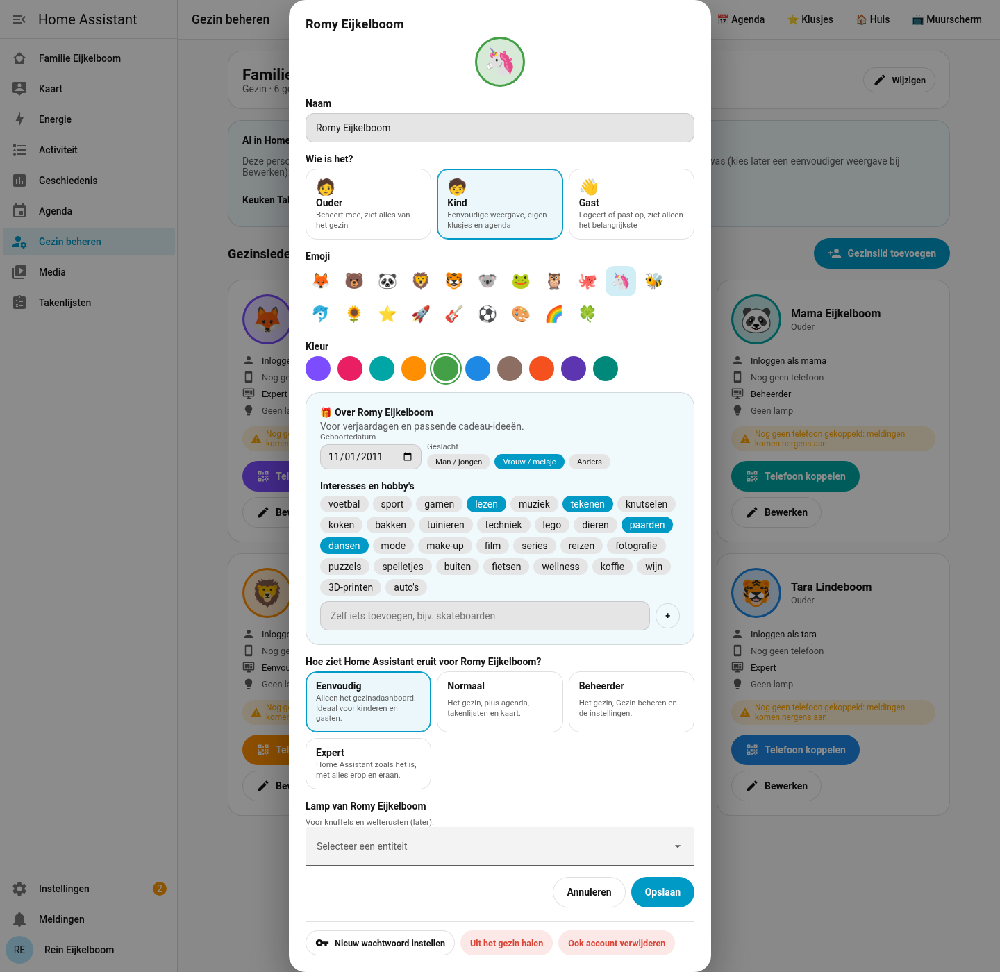 |

## Kaarten

```yaml
type: custom:family-gezin-card     # groet, datum, weer en wie er thuis is (weer: weather.x optioneel)
type: custom:family-vandaag-card   # vandaag, afval van morgen, binnenkort jarig
type: custom:family-agenda-card    # de gezinsagenda
type: custom:family-klusjes-card   # klusjes: kind ziet de eigen tegels, ouder ziet iedereen (lid: <id> = altijd die persoon)
type: custom:family-taken-card     # gezinstaken (compact: true = 'Mijn taken' met snel toevoegen)
type: custom:family-boodschappen-card   # (compact: true = tikbare lijstjes met snel toevoegen)
type: custom:family-eten-card      # het weekmenu (compact: true = 'Vanavond eten we')
type: custom:family-recepten-card  # recepten: zoeken, inplannen, op de lijst, importeren van een website
type: custom:family-kamers-card    # lampen, airco en meer per kamer (compact: true = één rij per kamer; kamer: <ruimte-id>)
type: custom:family-cadeaus-card   # verlanglijstjes, stiekem afvinken en cadeau-ideeën
weergave: maand                    # standaard voor wie nog niets koos: maand of weken
weken: 6                           # aantal weken in de weekplanner
```

Alle kaarten zijn ook via **Kaart toevoegen** te vinden en hebben een visuele editor. Die instellingen zijn alleen voor
wie in HA Family op de weergave *Expert* staat (of een beheerder die geen gezinslid is); de rest krijgt uitleg.

## Het gezinsdashboard aanpassen

Het gezinsdashboard kan op twee manieren (in **Gezin beheren**, bovenaan):

- **Automatisch** (standaard): het bouwt zichzelf en nieuwe functies van HA Family komen er vanzelf bij. Via ✏️ →
  *Dashboard bewerken* kies je welke tabbladen je ziet, welke kaarten op Thuis staan en de standaardweergave van de agenda.
  Experts kunnen in de code-editor eigen kaarten per tabblad (`extra: {thuis: [...]}`) en eigen tabbladen (`extra_tabs`)
  toevoegen.
- **Sjabloon**: HA Family zet het dashboard één keer neer als gewoon dashboard; daarna bewerk je elke kaart met de visuele
  editor, verplaats je ze en zet je er eigen kaarten bij. Na een update voegt **Nieuwe onderdelen toevoegen** alleen toe wat
  écht nieuw is; wat jij aanpaste of weghaalde, blijft zo. **Terug naar automatisch** en **Vorige versie terugzetten**
  kunnen altijd.

Het hele dashboard: `strategy: { type: custom:ha-family }`. Het muurscherm staat op `/gezin-muur`. Wil je het zelf aanpassen: open het dashboard → ✏️ → **Overnemen**.

## Wat komt er

HA Family groeit functie voor functie. Elke functie krijgt een plek in het dashboard, eigen kaarten en, waar nodig, een
wizard in Gezin beheren.

- [x] **Fundament:** gezin, beheer, telefoons koppelen, weergave per gezinslid, gezinsdashboard
- [x] **Gezinsagenda:** een kleur per persoon, maand of weekplanner, verjaardagen, afvalkalender
- [x] **Taken en klusjes:** klusjes met punten voor kinderen, boodschappenlijst op looproute
- [x] **Maaltijdplanner:** weekmenu, recepten, ingrediënten naar de boodschappen
- [x] **Kamers:** lampen, airco en meer per kamer, kamers en apparaten instellen zonder HA-instellingen
- [ ] **Waar is iedereen:** "ik kom eraan", melding bij thuiskomst
- [x] **Cadeaus:** verlanglijstjes, stiekem afvinken, cadeau-ideeën (met AI als die er is)
- [ ] **Kinderen:** ochtend- en avondroutines, beloningen, zakgeld
- [ ] **Samen:** voor stellen (stemming, knuffels, date-pot; uit [Ons hokje](https://github.com/Rein033/ha-ons-hokje))
- [ ] **Systeem:** back-ups en updates in gewone taal, gezinsthema

## Hoe het in elkaar zit

Eén HACS-pakket met vier delen:

| Deel | Waar | Wat |
|---|---|---|
| HA-Family-Integrations | `custom_components/ha_family/*.py` | het gezin en de gegevens per functie, als gewone HA-entiteiten |
| HA-Family-Management | `websocket.py`, `weergave.py`, `frontend/family-beheer.js` | het beheerpaneel en de weergave per gezinslid |
| HA-Family-Cards | `frontend/family-cards.js`, `frontend/family-ui.js` | kaarten in één ontwerp |
| HA-Family-Dashboard | strategie `custom:ha-family` in `frontend/family-cards.js` | het dashboard dat zichzelf opbouwt |

## Privacy

Alles blijft op jullie eigen Home Assistant. Iedereen met een account ziet het gezin (namen, kleuren, wie er thuis is).
Alleen beheerders kunnen gezinsleden, accounts en telefoons beheren.

## Ontwikkelen

```bash
uv venv --python 3.13 .venv && VIRTUAL_ENV=.venv uv pip install pytest-homeassistant-custom-component
.venv/bin/python -m pytest
python3 scripts/gen_strings.py   # strings.json en vertalingen (nl/en)
```

Bij een nieuwe versie: `version` in `manifest.json`, `VERSIE` in `family-ui.js` en de `?v=` in de imports gelijk houden
(de CI controleert dat).
